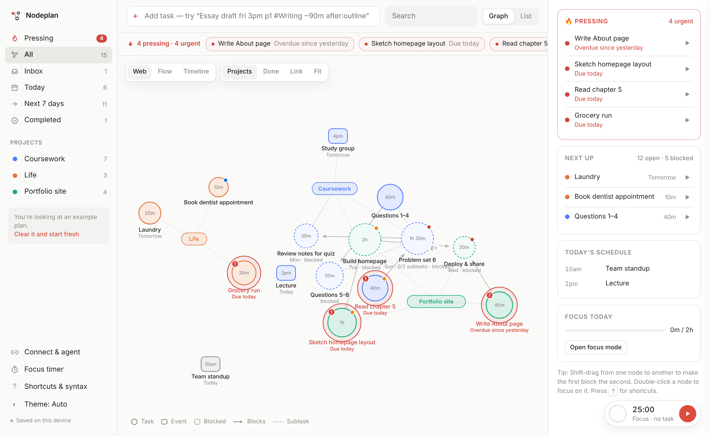
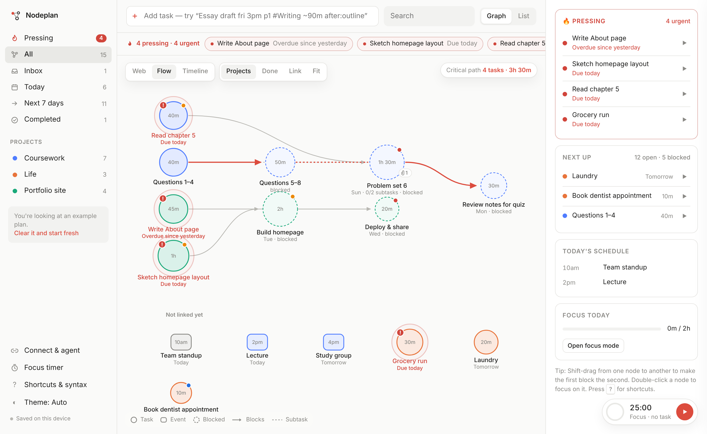
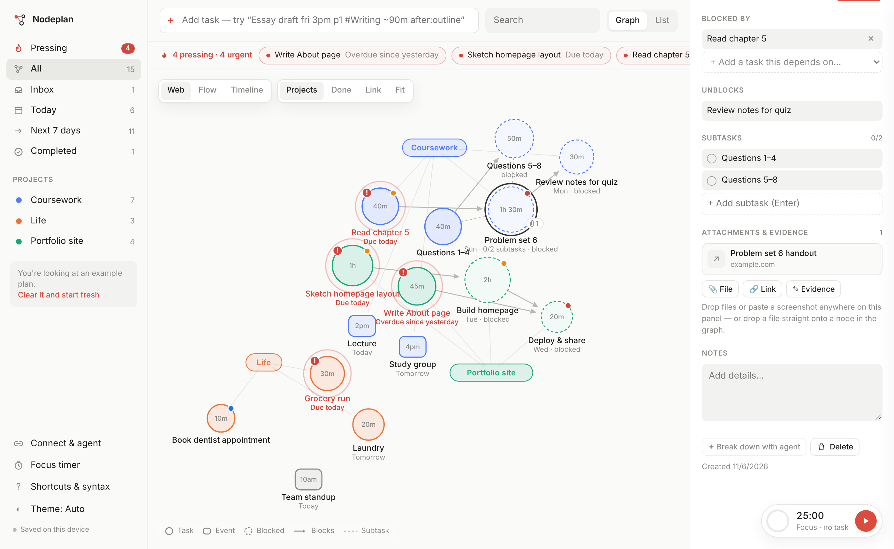
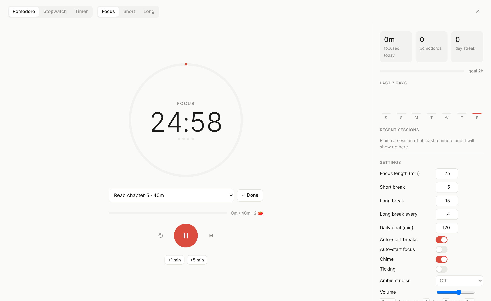

# Nodeplan

A minimalist to-do planner that shows your tasks and calendar as a **node graph**. It has a built-in focus timer, per-task attachments and evidence, and an AI agent that can pull plans in from other apps.



It's a single `index.html` with no build step. Open it in a browser and it works. Inside a Claude artifact it also gains account sync, the AI agent, live connectors and cloud file storage.

## Features

### See your plan as a graph
- **Nodes:** tasks are circles, sized by their estimate and colored by project. Calendar events are rounded squares.
- **Edges:** an arrow means one task blocks another, and a dashed line means a subtask. Blocked tasks have dashed outlines.
- **Three layouts:**
  - **Web:** a force-directed graph with tasks clustered around their project.
  - **Flow:** a left-to-right dependency DAG that highlights the **critical path**, the longest chain of blocking work.
  - **Timeline:** columns by day, lanes by project.
- **Interaction:**
  - **Shift-drag** from one node to another to create a dependency. Loops are refused.
  - Double-click a node to start focusing on it.
  - Hover a node to highlight its neighbors.



### Pressing tasks are always in front of you
Nodeplan works out what's pressing from deadlines, priority, effort and dependencies:

- **Urgent (red):** overdue, due today, or due within 3 hours.
- **Soon (amber):**
  - due tomorrow at P1 or P2
  - a big task (2 hours or more) due within 2 days
  - a bottleneck that blocks 2 or more tasks and is due within 3 days
  - a P1 task with no date
- **Propagation:** a task that blocks a pressing task becomes pressing too ("Unblocks …"), and so do the open subtasks of a pressing task.

Pressing tasks show up in several places:
- a breathing halo and a `!` badge in the graph, with a stronger pull toward the center
- a pressing bar under the toolbar
- a Pressing list in the sidebar
- a Pressing group at the top of the list view
- a card in the overview panel

### Familiar to-do basics
- **Natural-language quick add (Todoist-style):** `Essay draft fri 3pm p1 #Writing ~90m after:outline @school`

  | Syntax | Meaning |
  |---|---|
  | `tomorrow` · `fri` · `nov 12` · `in 3 days` · `next week` | due date |
  | `3pm` · `at 15:30` · `2-3pm` (a range makes an event) | time |
  | `p1`…`p4` or `!!!` | priority |
  | `#Project` · `@label` · `~45m` | project, label, estimate |
  | `after:word` · `under:word` | dependency / subtask |
- **Lists (Things-style):** Inbox, Today, Next 7 days, Completed and Projects, plus a list view grouped by day.
- **Everything else:** undo for every change, dark mode, keyboard shortcuts (press `?`), and a mobile layout.

### Attachments & evidence
Every task can hold **files, screenshots, links (including Claude artifacts, GitHub PRs and Google Docs) and evidence notes**.

- **Adding them:** paste a screenshot onto the selected task, drop a file on its panel, or drop it straight onto its node in the graph.
- **Proof of completion:** mark an evidence note as proof (for example "Submitted on Canvas, confirmation #A1B2") and it completes the task.
- **Calendar links:** meeting links in imported calendar events (Zoom, Meet) are attached automatically.



### Import from any app, no account needed
| App | How |
|---|---|
| Google Calendar | Settings → Import & export → Export → drop the **.zip** (every calendar inside is read) |
| Apple / Outlook Calendar | Export an `.ics` file and drop it in |
| Todoist | Project ⋯ → Export as a template → CSV |
| TickTick | Settings → Account → Generate backup (CSV) |
| Asana | Project ▾ → Export / Print → CSV |
| Notion | ⋯ → Export → Markdown & CSV (.zip or .csv) |
| Trello | Board JSON export |
| Obsidian / Markdown | `- [ ]` checklists, including the Tasks plugin emoji (📅 ⏫) |

Recurring events (`RRULE`) are expanded. Re-importing **updates** existing items instead of duplicating them. Export back out as `.ics`, a JSON backup or a Markdown checklist.

### Focus timer
- **Modes:** Pomodoro (configurable focus, short and long breaks, auto-start), stopwatch, and countdown.
- **Accurate timing:** it uses timestamps, so it stays correct in background tabs and after a reload.
- **Per-task tracking:** focus time is logged against each task, and a progress ring on its node compares time spent with the estimate.
- **Stats:** a daily goal, a streak, a 7-day chart and a session log.
- **Sound:** a chime, optional ticking, and brown or pink background noise generated in the browser.



### AI agent (inside Claude)
When it runs as a Claude artifact, the agent can do the following:
- edit the graph: add, update and link items, and attach evidence
- read live connectors (Google Calendar, Todoist, TickTick, Asana, Notion) for one-click sync
- pull tasks out of pasted text or screenshots
- plan your day around your events, break down large tasks, find dependencies and triage pressing work

## Running it

```bash
open index.html               # or double-click it
python3 -m http.server 8000   # or serve it locally, then visit localhost:8000
```

When it runs as a plain web page, data is saved in your browser (`localStorage`) and attachments are stored inline: images are compressed and other files are capped at about 150 KB. The agent and live connectors appear only inside Claude.

## Tests

```bash
pip install playwright && playwright install chromium
npm i d3@7.9.0 jszip@3.10.1 --prefix tests/vendor
python3 tests/test_app.py
```

The tests drive the app in headless Chromium. They check:
- the quick-add parser
- ICS (with recurrence), CSV, Markdown, Trello and ZIP imports, including de-duplication
- dependencies
- the timer state machine
- pressing-task detection
- attachments
- persistence after a reload

## License

MIT
